# 💽 CloudBase-RE

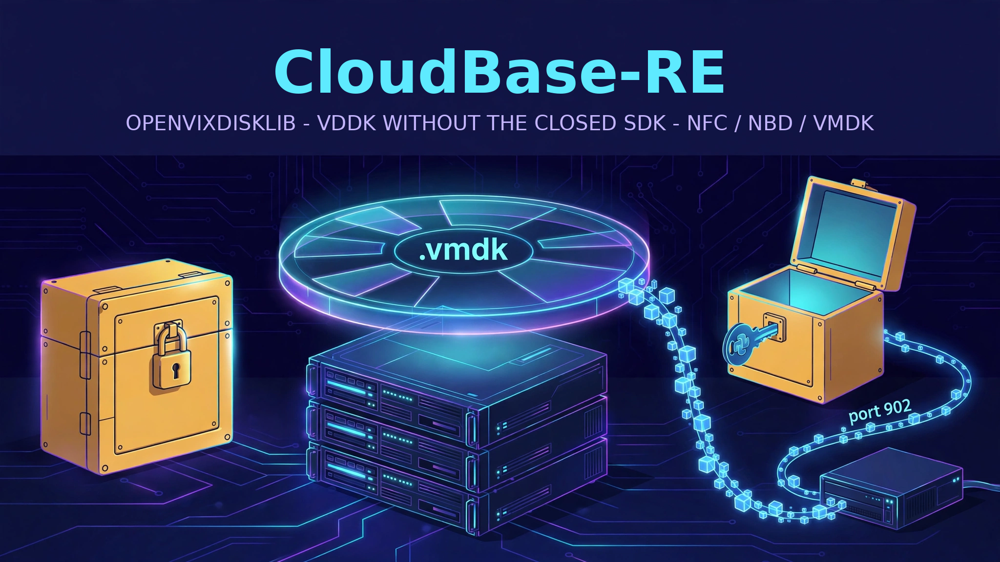


 

> ⏳ **Honest workflow status:** the real `ci.yml` + `docker-publish.yml` badges light up once the two workflow files are pasted into `.github/workflows/` (plural) and run — until then these show *pending paste* on purpose. The workflow files themselves are delivered with this project and are standard GitHub Actions (pytest + demo on Python 3.12; Docker Hub publish of `credkellar/cloudbase-re:latest` on push to main).

## 🧭 What is this about?

**CloudBase-RE** is an independent, open-source Python implementation of the OpenVixDiskLib concept, built to study and replicate the *functionality* of VMware's proprietary **libvixDiskLib (VDDK / Virtual Disk Development Kit)** - the library backup and migration tools use to read and write VMware virtual disks (`.vmdk`). The core challenge it takes on: interfacing with VMware vSphere/ESXi virtual disk formats and the low-level **Network File Copy (NFC)** and **Network Block Device (NBD)** protocols **without** closed-source SDK binaries or partner-portal downloads.

This build is a **clean-room lab implementation**: real VMDK descriptor parsing, a real NBD protocol codec (NBD is a public, documented protocol), a modelled NFC greeting/auth handshake, and a loopback lab fixture that stands in for an ESXi port-902 service - so the whole connect → open → read/write path runs and is tested locally, with synthetic disks only. Live connection to a real ESXi/vCenter stays behind HOLD gates.

## 🛠️ What this does

- 🔌 **Emulates VDDK interfaces** - `VixDiskLibHandle` exposes connect / open / read / write / get_info with sector addressing, mirroring the native SDK's shape (`openvixdisklib/handles.py`)
- 💽 **Parses real VMDK descriptors** - extents (RW SPARSE/FLAT), CID/parentCID, createType, DDB geometry + adapter, sector totals and capacity (`vmdk.py`), and creates synthetic lab disks (descriptor + zeroed flat extent)
- 🌐 **Streams blocks over NBD** - the public NBD handshake + the real 28-byte request / reply structs, implemented from the spec (`nbd.py`)
- 🤝 **Models the NFC handshake** - greeting + ticket-auth framing codec (magic, version, opcode, length-prefixed payloads) as described in the study doc (`nfc.py`)
- 🎫 **Models session + NFC tickets** - vCenter-style login → session token → NFC lease ticket (host, port 902, datastore path, expiry), fully offline (`session.py`)
- 📡 **Runs a loopback lab fixture** - an NBD server on 127.0.0.1 serving a synthetic disk, so writes and reads are exercised end-to-end with zero infrastructure
- 🗜️ **Compression adapter seat** - the interface a FastLZ adapter would expose, backed by an honest educational LZ77 codec (not byte-compatible FastLZ) (`compression.py`)
- ❗ **Readable errors** - Python exceptions with plain-English messages replace cryptic hex SDK codes (`errors.py`)
- 🧠 **Council seats** - Gemini Carbon 4 Extended Thinking (DECIDER) + Muse (advisor, exactly 4 advice, never overrides) (`council.py`)
- 📚 **Full study catalogue** - all **20 problems** and **20 reasons** from the Gemini study doc live in `problems.py` as data (the top 10 of each are in the sections below)

## ⚙️ How this works

1. 🎫 **Inventory & session login** - (modelled) authenticate against vCenter/ESXi via standard SOAP-style login (`pyVmomi` is the real-world library; here it is an offline model) and receive a session token + NFC ticket.
2. 🤝 **Socket handshake** - open a connection to the ESXi host port 902 service: NFC greeting + ticket authentication frames negotiate the disk lease.
3. 💽 **Disk sector operations** - precise read/write block commands target the `.vmdk` extents on the datastore - in this build, the loopback fixture's synthetic disk, through the real NBD request/reply structs.
4. 🗜️ **Stream processing & decompression** - incoming payload frames are parsed and decompressed through the adapter interface before raw sector data returns to the caller.

## 🎯 Who is this for?

- ☁️ **Cloud & DevOps engineers** - automating migrations from VMware to OpenStack, KVM, or public clouds
- 💾 **Backup & disaster-recovery builders** - lightweight pipelines that read/write VMDK blocks without bulky vendor SDKs
- 🔍 **Infrastructure security auditors & researchers** - studying proprietary virtualization protocols via clean-room implementation

## 😎 Why is this cool?

1. **Clean-room engineering triumph** - complex enterprise protocols rebuilt from scratch.
2. **AI-assisted protocol dissection** - packet analysis + byte-struct decoding as a study method.
3. **Bypassing monopolistic SDKs** - challenges gated partner portals on infrastructure interoperability.
4. **Transparent binary protocols** - black-box communication turned into readable Python.
5. **Direct socket mastery** - raw TCP on port 902 with hypervisor auth services.
6. **Bridge between high- and low-level** - pyVmomi inventory management meets byte manipulation.
7. **Rapid modernization** - legacy enterprise architecture adapted to agile workflows.
8. **Protocol agility** - fork, tweak, and optimize behaviour without waiting on vendor updates.
9. **Educational goldmine** - a masterclass in packet capture, frame parsing, reverse engineering.
10. **Open-source resilience** - an ecosystem independent of abrupt vendor policy shifts.

## 🧩 What problems this solves?

1. **Vendor SDK dependency lock-in** - removes the strict requirement to download official restricted VDDK binaries - clean-room Python instead.
2. **Partner portal bottlenecks** - no blocked/restricted portal download stands between a backup tool and its disk library.
3. **Heavy C/C++ binary bloat** - a lightweight Python implementation replaces rigid compiled C libraries.
4. **Complex cross-compilation hurdles** - no platform-specific C headers or .so/.dll juggling.
5. **Cross-platform compatibility gaps** - interfaces with VMware storage backends from non-traditional environments.
6. **Integration friction with Python tooling** - Python backup scripts bridge directly to low-level ESXi disk streams.
7. **License compliance friction** - a clean-room implementation gives open-source developers a transparent alternative.
8. **Opaque protocol black boxes** - open reverse engineering demystifies undocumented network block handshakes.
9. **CI/CD pipeline restrictions** - no proprietary SDK files in pipelines and no cumbersome proxy appliances.
10. **Datastore access inefficiencies** - streamlined reading and writing of .vmdk files.

> 📚 The full catalogue - all 20 problems and all 20 reasons from the study doc - is in `openvixdisklib/problems.py`.

## 📦 How to install this — step-by-step

### Option A — run it locally

1. 📥 Clone the repo:
   ```bash
   git clone https://github.com/credkellar/CloudBase-RE.git
   cd CloudBase-RE
   ```
2. ▶️ Run the end-to-end demo (synthetic disk, session, NFC model, NBD fixture, verified sector write/read):
   ```bash
   python3 main.py demo
   ```
   Expected tail: `CHECKS: 12/12`
3. 🧪 Run the tests:
   ```bash
   pip install pytest
   python3 -m pytest -q
   ```
   Expected: `11 passed`

### Option B — Docker

1. 🐳 Build: `docker build -t credkellar/cloudbase-re:latest .`
2. ▶️ Run: `docker run --rm credkellar/cloudbase-re:latest`
3. 🧩 Or Compose: `docker compose up --build`

## 📋 Requirements

- 🐍 Python **3.11+** - **zero third-party dependencies** (standard library only)
- 🧪 `pytest` - only for running the test suite
- 🐳 Docker - optional, for Option B
- 🔑 Optional seats, names only: `GEMINI_API_KEY` (Carbon 4) and `MODEL_API_KEY` (Muse, paid: key creation free, usage pay-as-you-go) light up the council seats; `VCENTER_USER`/`VCENTER_PASSWORD` are env *names* only in this build - values are never read
- 🚫 No VMware SDK, no vCenter, and no ESXi host are required - or contacted - by this build

## 🧒 Explain in 5th grade English

Imagine a computer inside a computer - that is a virtual machine. Its whole hard drive is saved as one big file, like saving an entire LEGO castle as a single box. Big companies sell a special key that lets programs open the box and read the pieces. That key is hard to get. This project is like a kid who studied how the box opens and built his **own** key out of regular parts, in the open, so anyone can learn from it. Talking to the box uses a secret handshake language over the network; this project writes that handshake down in plain Python anyone can read. But safety first: the key is only ever tried on **toy boxes we made ourselves** - never on anyone's real castle.

## 🗂️ Project structure

```text
CloudBase-RE/
├── main.py                        ▶️ demo + CHECKS (12/12)
├── openvixdisklib/
│   ├── __init__.py                📦 version
│   ├── vmdk.py                    💽 descriptor parser + synthetic disk creator
│   ├── session.py                 🎫 vCenter session + NFC ticket model (offline)
│   ├── nfc.py                     🤝 NFC greeting/auth framing codec (model)
│   ├── nbd.py                     🌐 NBD codec + loopback lab fixture server/client
│   ├── handles.py                 🔌 VixDiskLibHandle API (connect/open/read/write)
│   ├── compression.py             🗜️ LZ77 adapter (FastLZ-interface seat)
│   ├── errors.py                  ❗ readable VixError hierarchy
│   ├── council.py                 🧠 Carbon 4 DECIDER + Muse advisor
│   ├── gates.py                   ⛔ 10 HOLD gates
│   └── problems.py                📚 20 problems + 20 reasons (study doc)
├── tests/test_openvixdisklib.py   🧪 pytest (11 passed)
├── Dockerfile                     🐳 python:3.12-slim
├── docker-compose.yml             🧩 one service
├── pyproject.toml                 📦 package metadata
└── README.md                      📖 this file
```

## 📊 Diagrams — one per script

### 📜 `main.py`

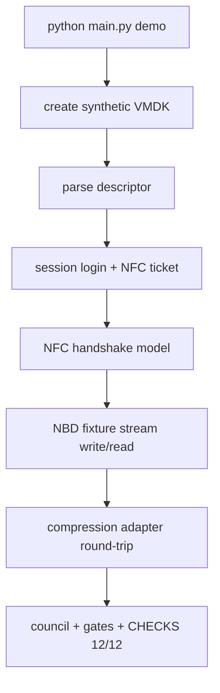

### 📜 `openvixdisklib/vmdk.py`

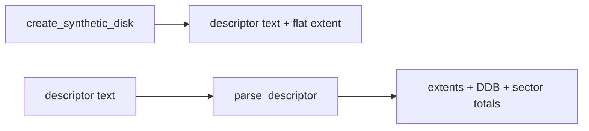

### 📜 `openvixdisklib/session.py`

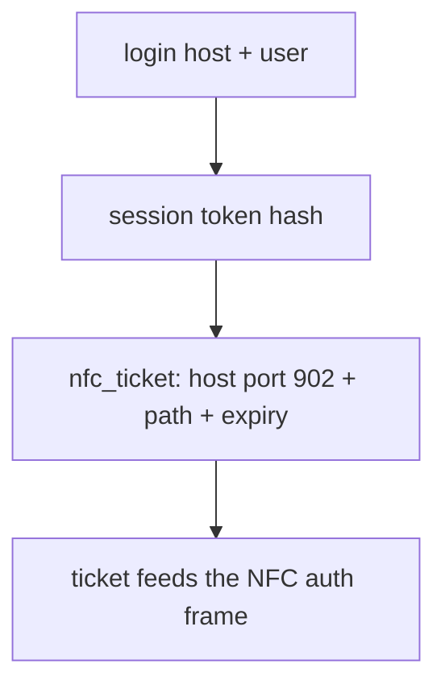

### 📜 `openvixdisklib/nfc.py`

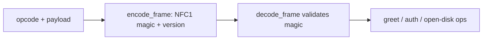

### 📜 `openvixdisklib/nbd.py`

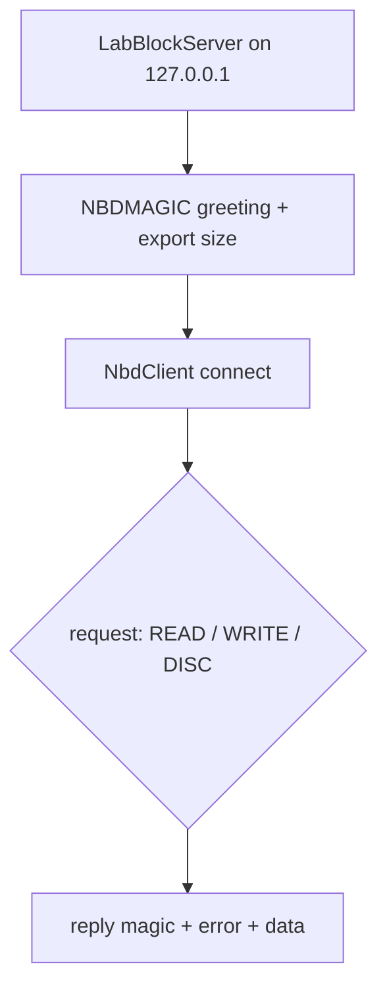

### 📜 `openvixdisklib/handles.py`

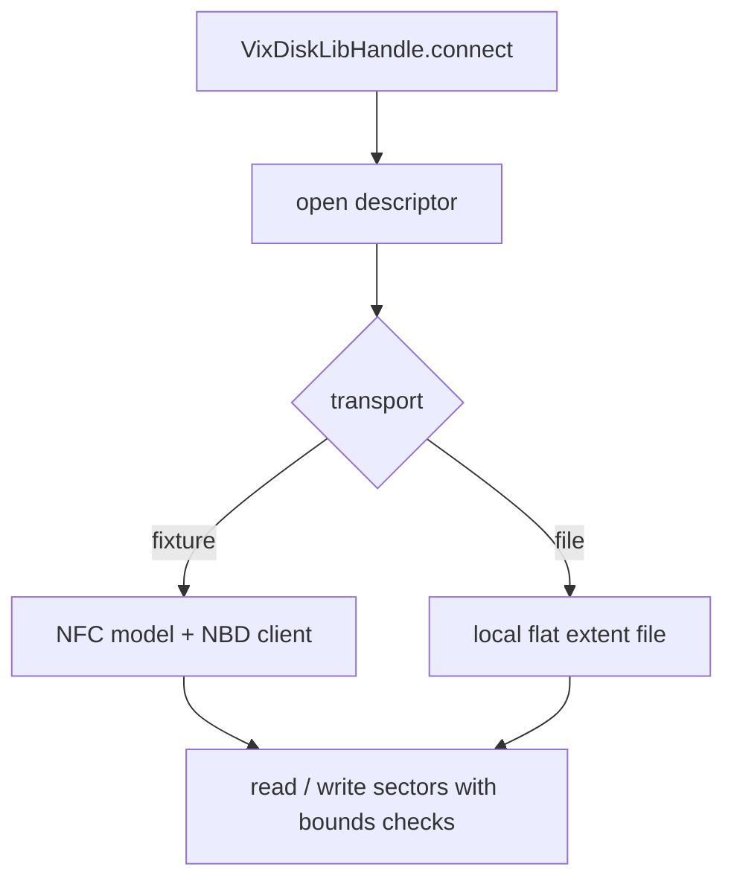

### 📜 `openvixdisklib/compression.py`

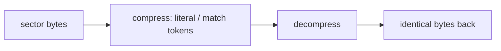

### 📜 `openvixdisklib/errors.py`

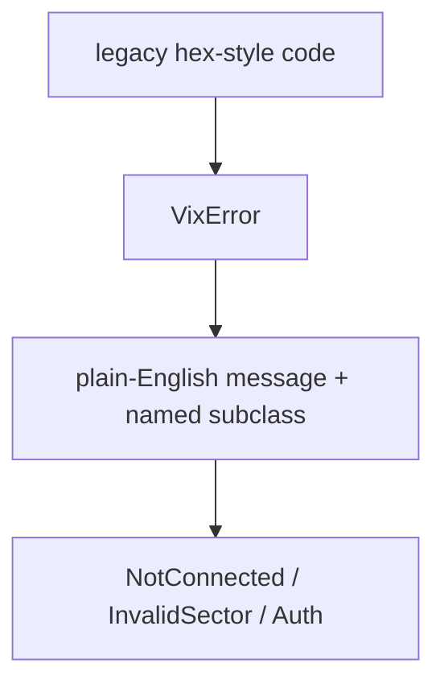

### 📜 `openvixdisklib/council.py`

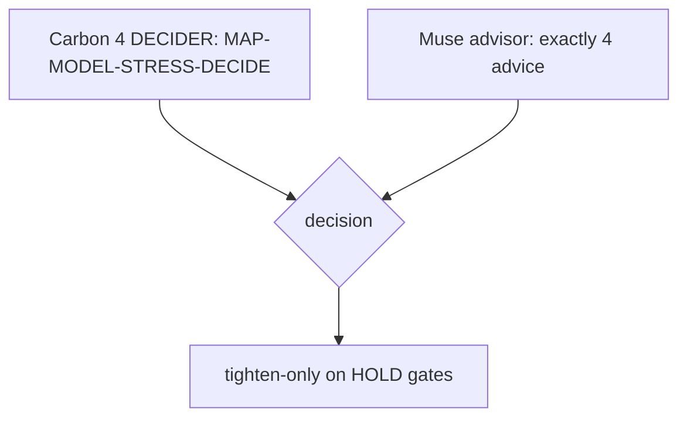

### 📜 `openvixdisklib/gates.py`

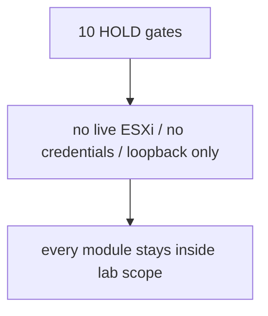

### 📜 `openvixdisklib/problems.py`

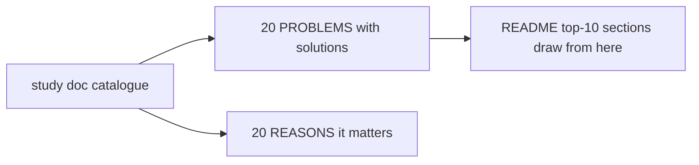

## ⛔ HOLD gates (10)

1. 🚫 **No live ESXi/vCenter connection** - the only peer is the loopback lab fixture (127.0.0.1); dialing a real host on port 902 is not implemented
2. 🔑 **No credential values** - `VCENTER_USER` / `VCENTER_PASSWORD` are env NAMES only; values never read, stored, logged, or sent
3. 💽 **No writes to a real datastore** - sector writes land only on synthetic lab disks
4. 🧼 **Clean-room study only** - behaviour modelled from the study doc + the public NBD spec; no VMware code or binaries included
5. ⚖️ **No SDK-bypass for production** - educational/interop research artifact, not a production backup tool or licensing workaround
6. 🗜️ **Compression honesty** - the LZ77 adapter is NOT byte-compatible FastLZ; never feed it real FastLZ streams
7. 🎫 **No pyVmomi live session** - session + NFC ticket are offline models
8. 🏠 **Loopback only** - the fixture binds 127.0.0.1, ephemeral port, exactly one connection
9. 🧪 **Synthetic disks only** - never point the file transport at a production .vmdk
10. ❗ **Errors stay readable** - no raw hex codes surface to users

## ✅ Verification

```text
$ python3 main.py demo
disk: 1 MiB, 2048 sectors ... session ticket -> port 902 ... NBD write/read identical
CHECKS: 12/12
$ python3 -m pytest -q
11 passed
```

## 📄 License

MIT

---

*Built from Darion's Gemini study doc on Cloudbase/OpenVixDiskLib - clean-room, lab-first, honest scope: the NBD codec and VMDK parser are real, the NFC handshake and vCenter session are models, the peer is a loopback fixture, and no real hypervisor is ever contacted by this build.* 💽
